<div align="center">


# Tempus Remedium

**Os seus medicamentos e doses de hoje, em dia.**

**Por [Dra. Maria Cortês Ferreira](https://mariacf.pt)**, médica de família · [mariacf.pt/apps](https://mariacf.pt/apps/)

[](https://github.com/neteinstein/Tempus-Remedium/actions/workflows/pr.yml)


<a href="https://github.com/neteinstein/Tempus-Remedium/raw/main/docs/tempus-remedium.mp4">
  
</a>

<sub>▶ <a href="https://github.com/neteinstein/Tempus-Remedium/raw/main/docs/tempus-remedium.mp4">Ver com som</a> · 24 segundos</sub>

</div>

---

Medication and dose manager, in European Portuguese. It shows what to take today and when
(**HOJE**), which medications are running out (**REPOR EM BREVE**, as jars or blister packs),
and keeps a history of the doses taken. Android first, plus a reduced web version (not deployed
for now, see [CI_CD.md](CI_CD.md#deploy-web)). The look
follows the author's site, [mariacf.pt](https://mariacf.pt): Fraunces and Plus Jakarta Sans,
calm blues, frosted cards, and a light and a dark theme.

<p>
  
  
  
</p>
<p>
  
  
  
</p>

**Forms and recurrence**

<p>
  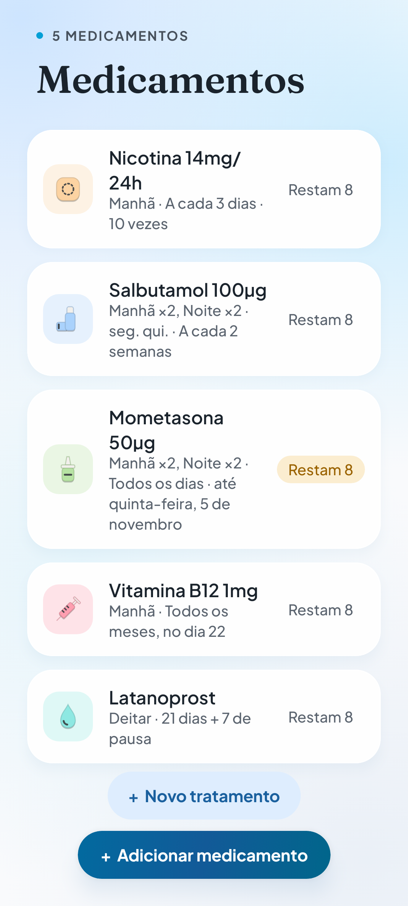
  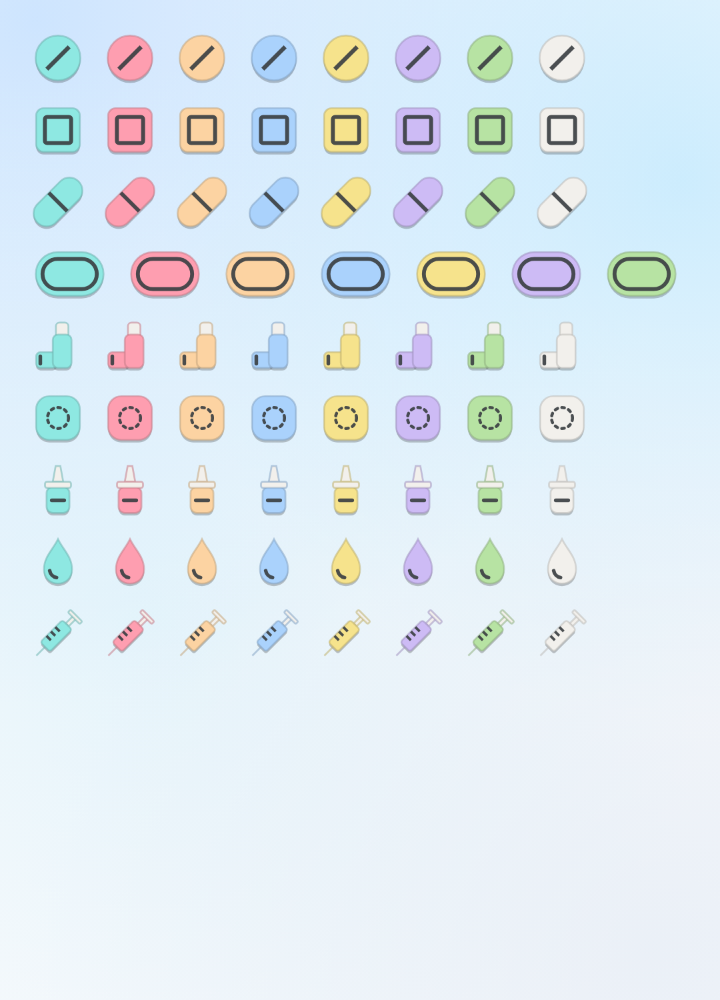
  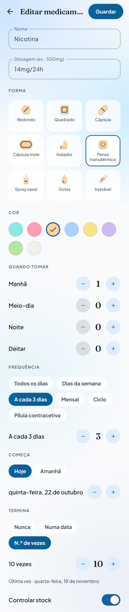
</p>

**Widgets, alerts and reminders**

<p>
  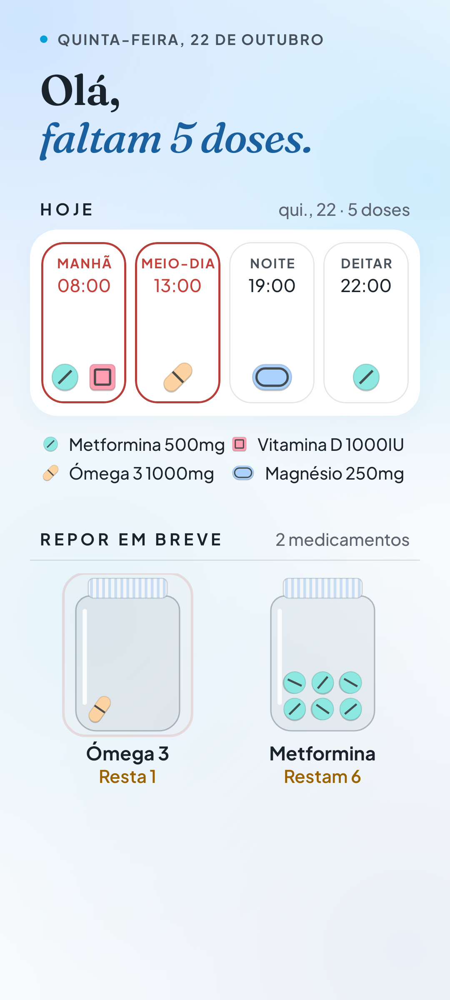
  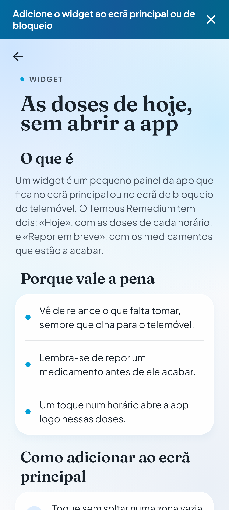
  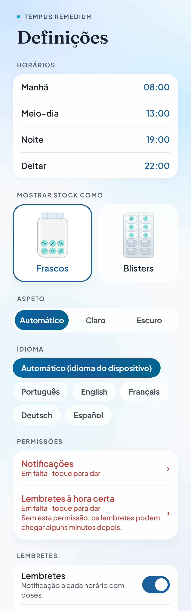
</p>
<p>
  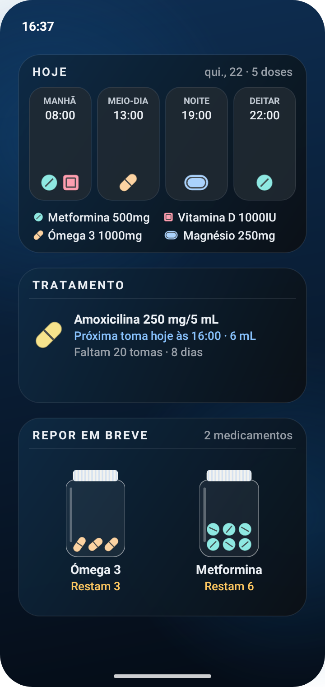
  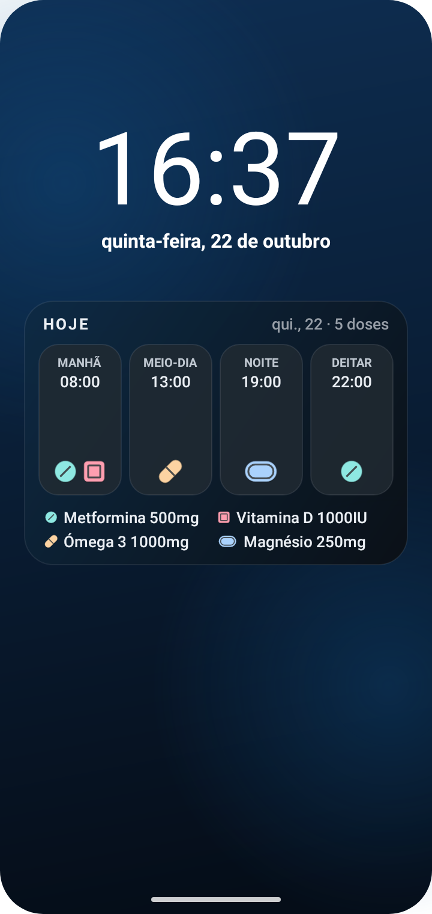
</p>
<p>
  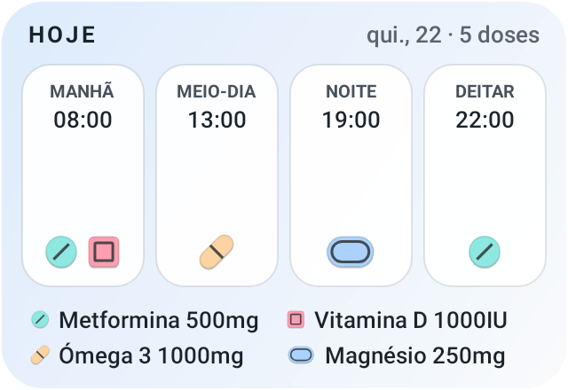
  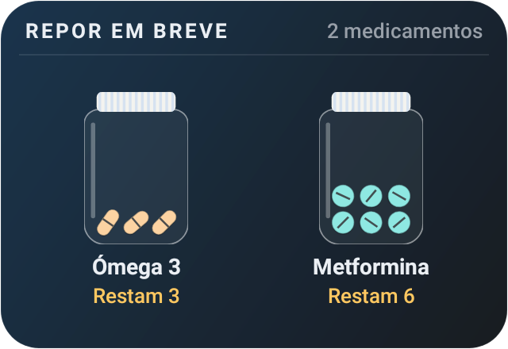
  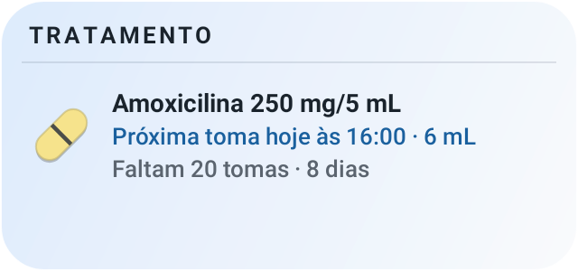
</p>
<p>
  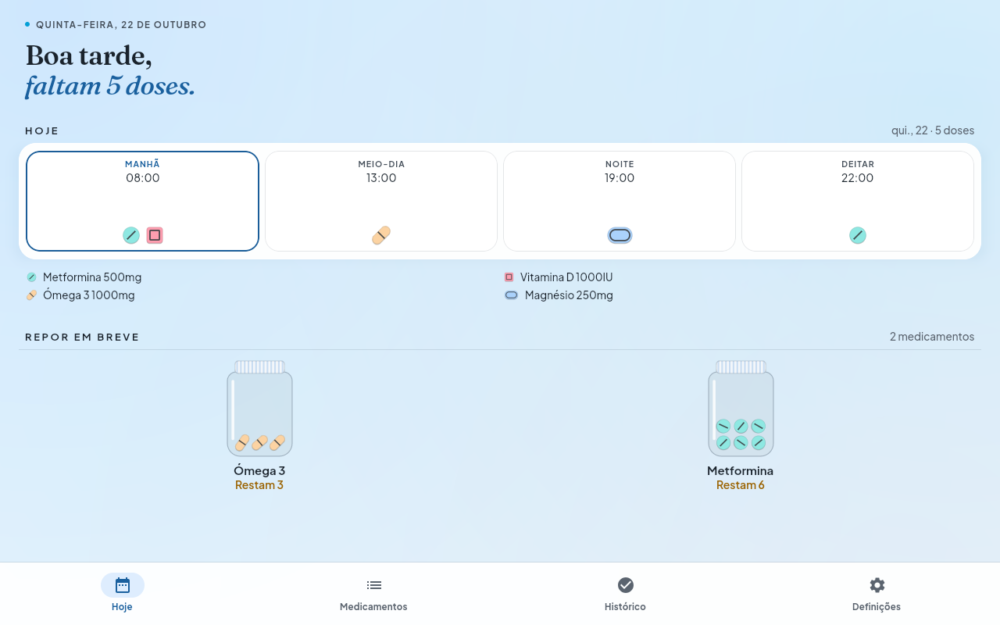
  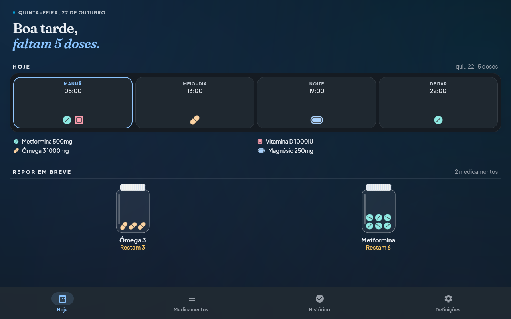
</p>

## Features

| | Android | Web |
| --- | :---: | :---: |
| HOJE: doses by MANHÃ / MEIO-DIA / NOITE / DEITAR, mark as taken or skipped; slots past their time with doses still pending turn **red** | ✅ | ✅ |
| REPOR EM BREVE: stock tracking, low-stock list, refill, shown as **jars or blister packs**; a jar or blister that runs out today or tomorrow **pulses red** until tapped | ✅ | ✅ |
| Medications: name, strength, form (pills, capsules, inhaler, patch, nasal spray, drops, injection) and colour, slots, recurrence (daily, weekdays every N weeks, every N days, monthly, on/off cycles; start date; ends never, on a date or after N times), stock | ✅ | ✅ |
| Courses (e.g. antibiotics): a dose every N hours, ending after N days, N doses, on a date or when the pack runs out; dose, interval and length suggested by the author's [dose calculator](https://mariacf.pt/calculadora-doses/) | ✅ | ✅ |
| History: 30-day adherence | ✅ | ✅ |
| Configurable slot times; automatic, light or dark theme | ✅ | ✅ |
| Reminder notifications with **Tomei** / **Adiar 10 min**, shown on the lock screen (names can be hidden) | ✅ | Only while the app is open, without names or buttons (Definições → Avisos com a app aberta) |
| Reminders in the phone's calendar: the next 90 days as events with an alert, without names, that ring with the app closed (Definições → Adicionar ao calendário; a snapshot to add again after changes) | — | ✅ |
| Number of doses due on the app icon | — | ✅ Installed web app, where the system supports it |
| Low-stock notifications | ✅ | — |
| Home-screen widgets: Hoje, Repor em breve and Tratamento (also offered for the lock screen where the system supports it), with previews in the widget picker | ✅ | — |
| "Add the widget" bar and a step-by-step guide (home and lock screen), with one-tap pinning where the launcher allows it | ✅ | — |
| Permissões section in Definições: a missing reminder permission (notifications, on-time alarms) shows in red, with a red bar on top that leads there | ✅ | — |
| Installable on the home screen, works offline (manifest and service worker) | — | ✅ |
| Install bar in a phone's browser: on iPhone/iPad, how to add the app to the home screen; on Android, a link to the native app on Google Play | — | ✅ |
| Data storage | On the device | In the browser (localStorage) |

Português (pt-PT), English, Français, Deutsch and Español: the device or browser language by default, or the one chosen in Definições → Idioma. No account and no
server: data never leaves the device or browser. The app supports care and does not replace
advice from a doctor or pharmacist.

## Build

Requires JDK 21 and, for Android, the Android SDK (`scripts/setup-android-sdk.sh` installs one).

```bash
./gradlew assembleDebug                        # Android APK
./gradlew :webApp:wasmJsBrowserDevelopmentRun  # web app on a local dev server
./gradlew :core:jvmTest :androidApp:testDebugUnitTest
```

Releases are built and published by CI on every push to `main` (GitHub Releases, and the Play
Console once configured); see [CI_CD.md](CI_CD.md).

More commands and conventions: [AGENTS.md](AGENTS.md). Pipelines: [CI_CD.md](CI_CD.md).
Design source of truth: [docs/design/REFERENCE.md](docs/design/REFERENCE.md).

## Author

**Dra. Maria Cortês Ferreira**, family doctor. More of her work: [mariacf.pt](https://mariacf.pt).

## Licences

Fonts, both under the SIL Open Font License 1.1:
Fraunces © The Fraunces Project Authors ([licenses/Fraunces-OFL.txt](licenses/Fraunces-OFL.txt)) and
Plus Jakarta Sans © The Plus Jakarta Sans Project Authors ([licenses/PlusJakartaSans-OFL.txt](licenses/PlusJakartaSans-OFL.txt)).
