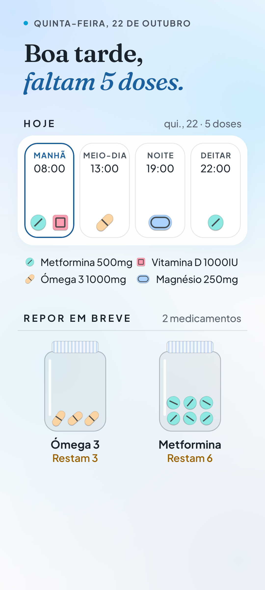
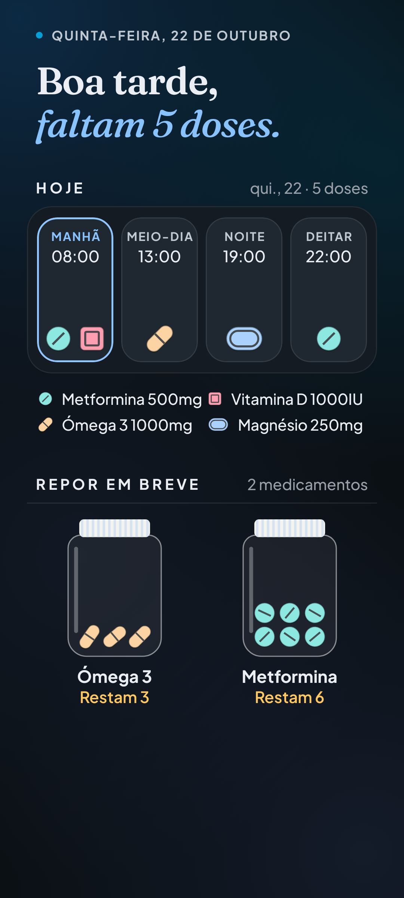
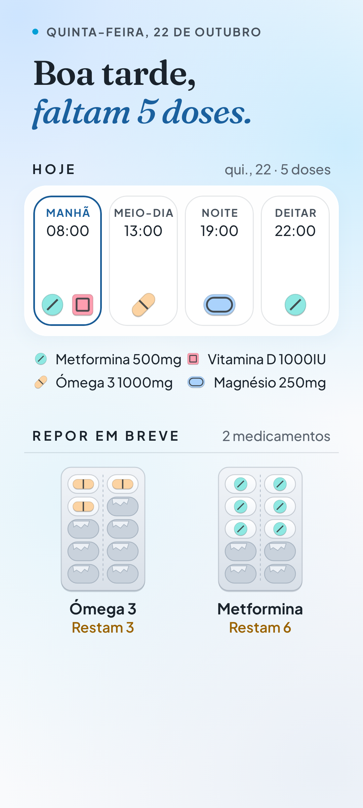
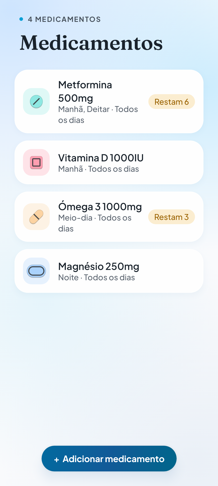
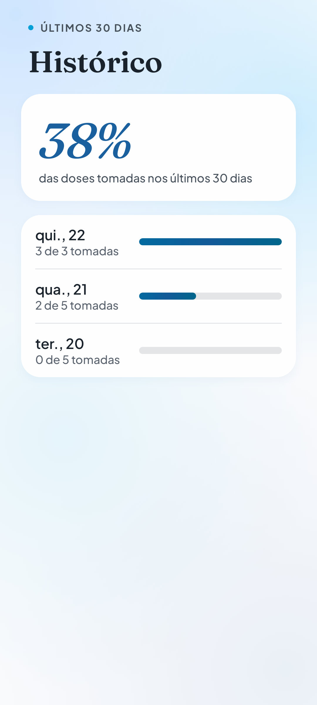
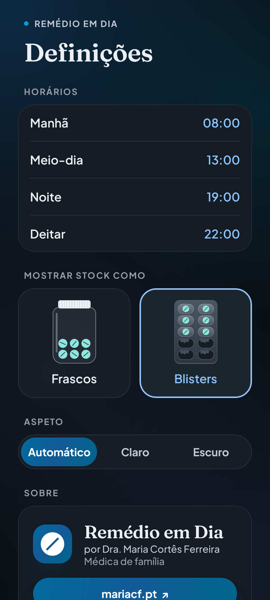

# Remédio em Dia

**Por [Dra. Maria Cortês Ferreira](https://mariacf.pt)**, médica de família · [mariacf.pt](https://mariacf.pt)

Medication and dose manager, in European Portuguese. It shows what to take today and when
(**HOJE**), which medications are running out (**REPOR EM BREVE**, as jars or blister packs),
and keeps a history of the doses taken. Android first, plus a reduced web version. The look
follows the author's site, [mariacf.pt](https://mariacf.pt): Fraunces and Plus Jakarta Sans,
calm blues, frosted cards, and a light and a dark theme.

<p>
  
  
  
</p>
<p>
  
  
  
</p>

## Features

| | Android | Web |
| --- | :---: | :---: |
| HOJE: doses by MANHÃ / MEIO-DIA / NOITE / DEITAR, mark as taken or skipped | ✅ | ✅ |
| REPOR EM BREVE: stock tracking, low-stock list, refill, shown as **jars or blister packs** | ✅ | ✅ |
| Medications: name, strength, pill shape and colour, slots, frequency, stock | ✅ | ✅ |
| History: 30-day adherence | ✅ | ✅ |
| Configurable slot times; automatic, light or dark theme | ✅ | ✅ |
| Reminder notifications with **Tomei** / **Adiar 10 min**, shown on the lock screen (names can be hidden) | ✅ | — |
| Low-stock notifications | ✅ | — |
| Home-screen widgets: Hoje and Repor em breve (also offered for the lock screen where the system supports it) | ✅ | — |
| Data storage | On the device | In the browser (localStorage) |

pt-PT by default; English when the device or browser language is English. No account and no
server: data never leaves the device or browser. The app supports care and does not replace
advice from a doctor or pharmacist.

## Build

Requires JDK 21 and, for Android, the Android SDK (`scripts/setup-android-sdk.sh` installs one).

```bash
./gradlew assembleDebug                        # Android APK
./gradlew :webApp:wasmJsBrowserDevelopmentRun  # web app on a local dev server
./gradlew :core:jvmTest :androidApp:testDebugUnitTest
```

Releases are built and published by CI on every push to `main` (GitHub Releases, and the Play
Console once configured); see [CI_CD.md](CI_CD.md).

More commands and conventions: [AGENTS.md](AGENTS.md). Pipelines: [CI_CD.md](CI_CD.md).
Design source of truth: [docs/design/REFERENCE.md](docs/design/REFERENCE.md).

## Author

**Dra. Maria Cortês Ferreira**, family doctor. More of her work: [mariacf.pt](https://mariacf.pt).

## Licences

Fonts, both under the SIL Open Font License 1.1:
Fraunces © The Fraunces Project Authors ([licenses/Fraunces-OFL.txt](licenses/Fraunces-OFL.txt)) and
Plus Jakarta Sans © The Plus Jakarta Sans Project Authors ([licenses/PlusJakartaSans-OFL.txt](licenses/PlusJakartaSans-OFL.txt)).
